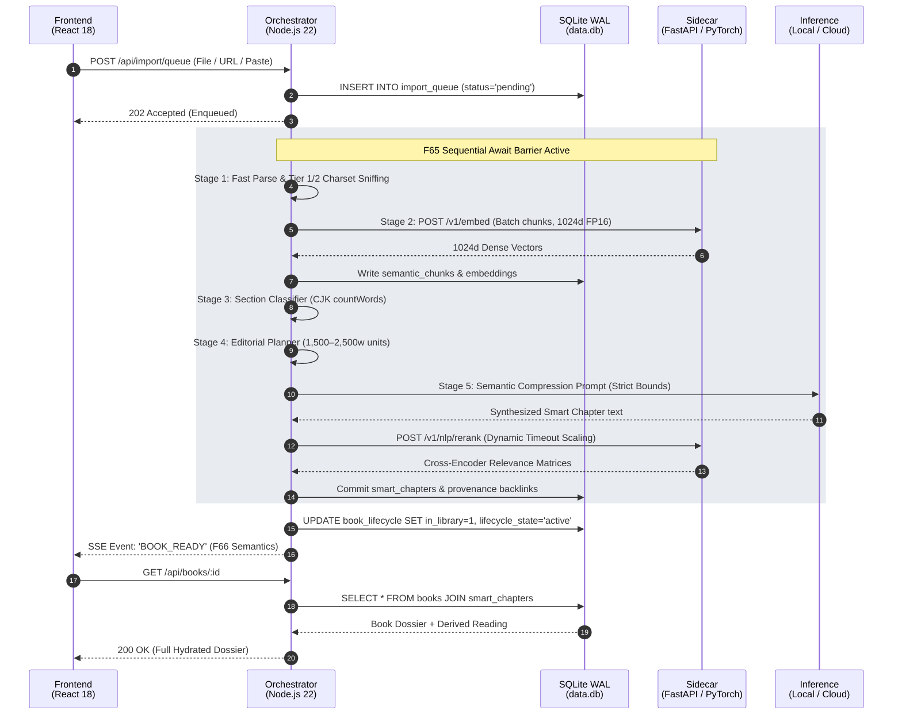

```mermaid
flowchart TD
    RawDoc["Incoming Document<br/>(PDF / EPUB / DOCX / RTF / MD / Web)"] --> S1A
    
    subgraph S1 ["Stage 1: Ingestion & Fast Parse"]
        S1A["Tier 1: UTF-8 BOM Probe (&lt;0.3ms)"] --> S1B{"Clean UTF-8?"}
        S1B -- Yes --> S1D["Layout AST Extractor"]
        S1B -- No --> S1C["Tier 2: jschardet Statistical Sniffer"]
        S1C --> S1D
        S1D --> S1E{"Zero Text Extracted?"}
        S1E -- Yes --> S1F["PaddleOCR Scanned Page Fallback"]
        S1E -- No --> S1G["F23 Legacy PUA Font Normalizer"]
        S1F --> S1G
    end

    S1G --> S2A

    subgraph S2 ["Stage 2: Semantic Indexing & Vectorization"]
        S2A["75-Word Merge-Back Chunker"] --> S2B["8K Max Character Guard"]
        S2B --> S2C["BGE-M3 FP16 Embedder (1024d)"]
        S2C --> S2D["Store Dense Vectors in SQLite WAL"]
    end

    S2D --> S3A

    subgraph S3 ["Stage 3: Section Classifier"]
        S3A["Extract Structural Metadata & TOC"] --> S3B["Role Separation: Body vs Front/Back Matter"]
        S3B --> S3C["CJK countWords Verification"]
    end

    S3C --> S4A

    subgraph S4 ["Stage 4: Editorial Planner"]
        S4A["Compute Total Body Word Count"] --> S4B["Partition into 1,500–2,500w Source Units"]
        S4B --> S4C["Boundary Snapping: ±10% Natural Chapter Breaks"]
        S4C --> S4D["Generate Authorial Abstract Synopsis"]
    end

    S4D --> S5A

    subgraph S5 ["Stage 5: Neural Compression & Attribution"]
        S5A["LLM Prompt: 'Compress, never summarize'"] --> S5B["Assess Target Words [240, 500]"]
        S5B --> S5C["Generate Smart Chapter Draft"]
        S5C --> S5D{"Hard Word Count Bounds Met?"}
        S5D -- No --> S5E["Prior-Draft Feedback Retry"]
        S5E --> S5C
        S5D -- Yes --> S5F["BGE Reranker v2 Cross-Encoder Scoring"]
        S5F --> S5G["Dynamic Timeout Governance (8s–60s)"]
        S5G --> S5H["Commit Deterministic Backlinks to SQLite"]
    end

    S5H --> Ready["Emit SSE 'BOOK_READY'<br/>Active in Library (in_library=1)"]
```

<p align="center">
  
</p>

<h1 align="center">Omnitome</h1>

<p align="center">
  <strong>A Local-First Neural Reading System with Loss-Bounded Semantic Compression, Deterministic Vector Provenance, and On-Device Speech Synthesis.</strong>
</p>

<p align="center">
  <a href="./LICENSE"></a>
  
  
  
  
  
  
  
  
  
</p>

<p align="center">
  <a href="https://github.com/avengersvstheflash/Omnitome/releases/download/v1.1.0/Omnitome_1.1.0_x64-setup.exe">
    
  </a>
  <a href="https://github.com/avengersvstheflash/Omnitome/releases/tag/v1.1.0">
    
  </a>
</p>

<p align="center">
  <a href="#interface-preview--the-two-representation-invariant">Interface Preview</a> •
  <a href="#abstract--the-compression-imperative">Abstract</a> •
  <a href="#mathematical-grounding--formal-invariants">Formal Invariants</a> •
  <a href="#system-architecture--multi-process-boundary">System Architecture</a> •
  <a href="#5-stage-ingestion--vector-attribution-pipeline">Ingestion Pipeline</a> •
  <a href="#comparative-systems-analysis">Comparative Analysis</a> •
  <a href="#empirical-benchmarks--hardware-telemetry">Benchmarks</a> •
  <a href="#sensory--perceptual-subsystems">Sensory Systems</a> •
  <a href="#first-run-experience--the-synthetic-archive">First-Run & Archive</a> •
  <a href="#quick-start--installation">Quick Start</a> •
  <a href="#documentation-hub">Docs</a> •
  <a href="#citation">Citation</a>
</p>

---

### 🖥️ Interface Preview: The Two-Representation Invariant

```text
┌──────────────────────────────────────────────────────────────────────────────────────────────────┐
│  OMNITOME v1.1.0 — [Split Reading Surface]                  [Classic] [Kokoro: af_heart] [_][□][✕]│
├─────────────────────────────────────────────────┬────────────────────────────────────────────────┤
│  ORIGINAL RESEARCH VIEW (Verbatim Ground Truth) │  OMNI READING VIEW (Loss-Bounded Lens ~7:1)    │
│  [Law 1: Source is paper · Immutable]           │  [Law 3: Navigable Provenance & Attribution]   │
├─────────────────────────────────────────────────┼────────────────────────────────────────────────┤
│                                                 │                                                │
│  § 14. Attention Mechanisms in Deep Networks    │  Chapter 3: Attention Scalability              │
│                                                 │                                                │
│  [Chunk #142 · Paragraph 14]                    │  Self-attention computes dynamic scalar        │
│  The fundamental limitation of recurrence lies  │  weights across token sequences by querying    │
│  in its sequential dependency structure. Step   │  key-value dot products scaled by matrix       │
│  t cannot proceed until step t-1 concludes. In  │  dimension sqrt(d_k) [p14]. This design        │
│  contrast, scaled dot-product attention maps    │  replaces sequential recurrence with parallel  │
│  queries and keys of dimension d_k to compute   │  matrix operations [p14], eliminating O(N)     │
│  attention matrices simultaneously across all   │  dependency bottlenecks while retaining full   │
│  token positions in parallel:                   │  context visibility across long tomes [p15].   │
│                                                 │                                                │
│    Attention(Q,K,V) = softmax(QK^T / √d_k) V    │  • Multi-head projections expand representation│
│                                                 │    subspaces across 8 parallel heads [p16].    │
│  This eliminates backpropagation vanishing      │  • Cross-encoder vector re-ranking bounds      │
│  gradients across extended horizons...          │    sentence attribution to verbatim sources.   │
│                                                 │                                                │
├─────────────────────────────────────────────────┴────────────────────────────────────────────────┤
│  ▶  02:14 / 08:35  ━━━━●━━━━━━━━━━━━━━━  [1.0x]  🔊 af_heart (Neural FP16)  │ Active: Sentence 2 │
└──────────────────────────────────────────────────────────────────────────────────────────────────┘
```

---

## 🔬 Abstract & The Compression Imperative

Omnitome addresses the core informational bottleneck of contemporary research and high-volume reading: the divergence between unstructured, long-form ground truth documents and lossy, ungrounded generative summaries.

Conventional large language model (LLM) reading tools summarize documents by discarding nuances, flattening technical depth, and hallucinating synthetic connective tissue to answer the question *"what is the gist?"*. Omnitome rejects lossy summarization in favor of **loss-bounded semantic compression** ($\sim 7:1$ compression ratio). Under this paradigm, every distinct technical concept, mathematical theorem, and evidentiary claim is strictly preserved, while syntactic redundancy, rhetorical flourishes, and non-essential connective padding are systematically condensed.

```text
┌────────────────────────────────────────────────────────────────────────────────────────┐
│                          THE COMPRESSION VS. SUMMARIZATION DILEMMA                     │
├───────────────────────────────────────────┬────────────────────────────────────────────┤
│         STANDARD SUMMARIZATION            │         OMNITOME SEMANTIC COMPRESSION      │
├───────────────────────────────────────────┼────────────────────────────────────────────┤
│ • Discards technical arguments & formulas │ • Preserves every theorem, claim, and step │
│ • Invents narrative connective tissue      │ • Retains authorial logical structure      │
│ • Floating, ungrounded synthetic text     │ • Deterministic, clickable provenance links│
│ • Answers: "What is the general gist?"    │ • Answers: "What if every sentence carried │
│                                           │            5–8× its information density?"  │
└───────────────────────────────────────────┴────────────────────────────────────────────┘
```

### The Three Foundational Laws

Every architectural decision and data pipeline in Omnitome conforms to three inviolable operational laws:

1. **Law 1: Source is paper.** The original document represents neutral, book-like, immutable ground truth. The system never mutates, truncates, or rewrites verbatim source text.
2. **Law 2: The lens is tinted.** Derived representations are explicitly identified, calibrated, and visually demarcated from ground truth.
3. **Law 3: Derivation never masquerades as source.** Every synthesized sentence must carry deterministic, clickable citations linking directly back to verbatim source paragraphs. Sentences lacking verified provenance are treated as architectural defects and visually rendered with distinct warning indicators (`text-ink-muted` with dotted underline).

> **The Architectural Moat:** *"Nobody wants compression. They want traceability."*  
> Competitors sell ephemeral summaries. Omnitome provides an audited, mathematically bounded, bi-directional reading lens over documents you own.

### 🔒 Local-First Architecture & Data Boundary

Omnitome is built around a **local-first** data contract designed for complete privacy and user ownership:
- **Offline / Local Mode (100% Private):** When paired with a local LLM runner ([Ollama](https://ollama.ai/) or [LM Studio](https://lmstudio.ai/)), all operations—document ingestion, structure parsing, BGE-M3 embedding (1024d), BGE Reranker v2 cross-encoding, SQLite WAL queries, and Kokoro-82M neural speech synthesis—execute **100% locally on your machine with zero data egress**. No document content, embeddings, or telemetry ever leave your device.
- **Cloud Synthesis Mode (Optional):** When a user explicitly configures a cloud AI provider (OpenRouter or Google Gemini API keys in the Welcome Wizard or Settings), document text slices are transmitted exclusively to that configured provider to synthesize compressed Smart Chapters. Vector attribution cross-encoding and neural speech synthesis continue to execute strictly on-device.
- **Desktop Runtime Note:** Omnitome's native desktop shell uses Microsoft WebView2. WebView2 is pre-installed on standard Windows 10 and Windows 11 systems; on minimal or legacy environments, the installer bootstraps the official evergreen WebView2 runtime from Microsoft if missing.

---

## 📐 Mathematical Grounding & Formal Invariants

Omnitome grounds its editorial, embedding, and vector attribution pipelines in provable operational bounds.

### Invariant 1: Loss-Bounded Semantic Compression Ratio ($C_r$)

Let $T_{\text{source}}$ represent the sequence of verbatim body tokens extracted from a source document, and let $T_{\text{omni}}$ represent the synthesized representation. The global compression ratio $C_r$ is defined as:

$$C_r = \frac{|T_{\text{source}}|}{|T_{\text{omni}}|} \approx 7.0 \pm 1.0$$

To prevent context collapse and quality degradation, the Editorial Planner partitions $T_{\text{source}}$ into discrete editorial source units $U_k$ governed by bounded word counts:

$$1,500 \le |W(U_k)| \le 2,500 \quad (\text{target ceiling: } 2,800 \text{ words})$$

Each source unit $U_k$ maps to exactly one synthesized Smart Chapter $S_k$, targeting an optimal reading length:

$$250 \le |W(S_k)| \le 360 \text{ words} \quad \left(\text{dynamic range: } [240, 500], \text{ hard bounds: } [150, 500]\right)$$

Any synthesized chapter falling outside the hard boundary $[150, 500]$ triggers an immediate synthesis rejection, feeding the prior draft back into the instruction context for iterative pruning.

### Invariant 2: Deterministic Hybrid Vector Attribution Bound

Let a source document be segmented into $K$ semantic chunks $\mathcal{C} = \lbrace c_1, c_2, \dots, c_K \rbrace$, where each chunk is encoded into a 1024-dimensional normalized dense vector $\mathbf{e}(c_k) \in \mathbb{R}^{1024}$ via BGE-M3 under sequence-bounded attention (2,048 tokens). Let a synthesized chapter consist of $M$ sentences $\mathcal{S} = \lbrace s_1, s_2, \dots, s_M \rbrace$.

The attribution mapping $\mathcal{A}(s_j)$ establishes deterministic provenance by identifying the supporting chunk set:

$$\mathcal{A}(s_j) = \lbrace c_k \in \mathcal{C} \mid \Phi(s_j, c_k) \ge \tau_{\text{provenance}} \rbrace$$

where the scoring kernel $\Phi(s_j, c_k)$ evaluates a convex combination of dense bi-encoder cosine similarity and FP16 cross-encoder re-ranking logits:

$$\Phi(s_j, c_k) = \lambda \cdot \left(\frac{\mathbf{e}(s_j) \cdot \mathbf{e}(c_k)}{\|\mathbf{e}(s_j)\|_2 \|\mathbf{e}(c_k)\|_2}\right) + (1 - \lambda) \cdot \sigma\left(\mathrm{logit}_{\text{rerank}}(s_j, c_k)\right)$$

### Invariant 3: Input-Calibrated Dynamic Re-ranker Timeout ($\mathcal{T}_{\text{rerank}}$)

Under high-density technical chapters containing numerous candidate paragraphs, static execution timeouts cause false fallbacks to centroid heuristics. Omnitome enforces dynamic hardware-calibrated timeout scaling (F71):

$$\mathcal{T}_{\text{rerank}}(N_{\text{cand}}, N_{\text{para}}) = \mathrm{clamp}\Big(8000 + (N_{\text{cand}} \cdot N_{\text{para}} \cdot 400) + (N_{\text{para}} \cdot 300), \, 8000,\, 60000\Big) \, \text{ms}$$

This guarantees that cross-encoder matrix evaluations finish deterministically, completely eliminating false centroid fallbacks on large 500K-word technical volumes.

### Invariant 4: Memory Invariance via F65 Sequential Ingestion Barrier

To prevent out-of-memory (OOM) crashes during continuous batch imports of large technical libraries, the Node.js orchestrator enforces a sequential await barrier:

$$\lim_{N \to \infty} \mathrm{RSS}_{\text{Node.js}}(N) \le 296 \, \text{MB} \quad \left(\text{cf. } 14.6 \, \text{GB unconstrained}\right)$$

### Invariant 5: Effective Word Count Metric for Logographic Scripts ($W_{\text{eff}}$)

Standard whitespace tokenization (`text.split(/\s+/)`) collapses logographic East Asian languages (CJK) into single-token strings, triggering catastrophic synthesis failures and memory blowouts. Omnitome evaluates effective word count via:

$$W_{\text{eff}} = W_{\text{whitespace}} + \alpha \cdot |\mathcal{G}_{\text{CJK}}|, \quad \text{where } \alpha = 0.70$$

---

## 🏛️ System Architecture & Multi-Process Boundary

Omnitome is engineered as a coordinated multi-process desktop system. Orchestrational state integrity is decoupled from PyTorch CUDA neural computation and native desktop lifecycle supervision.

```text
┌────────────────────────────────────────────────────────────────────────────────────────┐
│                             TAURI v2 DESKTOP SHELL (Rust)                              │
│       • Native Desktop Container & Window Host       • Dynamic Port Discovery          │
│       • Child Process Lifecycle Supervisor           • Clean Tree Teardown (taskkill)  │
└───────────────────────────────────────────┬────────────────────────────────────────────┘
                                            │ Local Webview IPC
                                            ▼
┌────────────────────────────────────────────────────────────────────────────────────────┐
│                      REACT 18.3 FRONTEND CLIENT (Vite + Tailwind CSS)                  │
│       • Dual-Pane Research & Omni Reading            • KaTeX Mathematical Typesetting │
│       • Synchronized Audio Narration Deck            • 5 Theme-Synchronized Palettes   │
└───────────────────────────────────────────┬────────────────────────────────────────────┘
                                            │ HTTP REST / SSE (Port 3000)
                                            ▼
┌──────────────────────────────────────────────┐ ┌───────────────────────────────────────┐
│         NODE.JS 22 LTS ORCHESTRATOR          │ │        FASTAPI PYTHON SIDECAR         │
│ • SOLE Writer to SQLite Database (WAL Mode)  │ │ • PyTorch FP16 CUDA Vectorization     │
│ • F65 Pipeline Sequential Await Barrier      │◄┼── REST (127.0.0.1:8765)               │
│ • Single-Worker FIFO Ingestion Queue Daemon  │ │ • BGE-M3 Embedder (1024d)             │
│ • Peak Resident Memory: 296 MB               │ │ • BGE Reranker v2 Cross-Encoder       │
│ • F52 book_lifecycle State Machine Engine    │ │ • Kokoro-82M Neural Audio TTS         │
│ • Shared Web Audio SFX Player                │ │ • F43 Idle Lifecycle Eviction Daemon  │
└──────────────────────┬───────────────────────┘ └───────────────────────────────────────┘
                       │ SQLite WAL Operations (Sole Writer)
                       ▼
┌────────────────────────────────────────────────────────────────────────────────────────┐
│                        LOCAL SQLITE STORAGE ENGINE (storage/data.db)                   │
│        • WAL Mode (user_version = 3)        • Independent llm_usage Cost Ledger        │
│        • books, chapters, smart_chapters    • durable book_lifecycle Snapshots         │
└────────────────────────────────────────────────────────────────────────────────────────┘
```

### The Multi-Process Sequence Diagram



### Architectural Invariants

1. **Node.js is the SOLE Writer to SQLite:** Neither Python sidecars, Rust Tauri supervisors, nor client scripts may open or write to `storage/data.db`. All write mutations originate from Node.js database repositories.
2. **Stateless Neural Computation:** The Python sidecar is completely stateless with respect to long-term application state. It performs mathematical vectorization, cross-encoder scoring, and audio synthesis, returning structured results via HTTP REST.
3. **Strict Client-Server Isolation:** The frontend communicates **exclusively** with Node.js via HTTP REST and Server-Sent Events (SSE). It has zero direct communication channels with Python or SQLite.
4. **Desktop Process Tree Superversion:** Upon window closure, Tauri intercepts termination signals and dispatches recursive process tree terminations (`taskkill /F /T` on Windows) to permanently prevent orphan Node or Python processes.

---

## ⚡ 5-Stage Ingestion & Vector Attribution Pipeline

Documents uploaded to Omnitome pass through a deterministic five-stage ingestion pipeline protected by the F65 Await Barrier:

```text
┌────────────────────────────────────────────────────────────────────────────────────────┐
│                       5-STAGE INGESTION & ATTRIBUTION PIPELINE                         │
├─────────────────┬──────────────────────────────────────────────────────────────────────┤
│ Stage 1: Ingest │ • Tier 1+2 statistical charset detection (<0.3ms UTF-8 fast-path)    │
│ & Fast Parse    │ • Layout-aware PyMuPDF text & heading AST extraction                 │
│                 │ • PaddleOCR fallback for scanned pages & F23 PUA font normalizer     │
├─────────────────┼──────────────────────────────────────────────────────────────────────┤
│ Stage 2: Index  │ • Semantic chunking with 75-word merge-back & 8K character ceiling   │
│ & Vectorize     │ • BGE-M3 dense vector embeddings (FP16 CUDA, 2,048 bounded attention)│
├─────────────────┼──────────────────────────────────────────────────────────────────────┤
│ Stage 3: Classify│ • Structural role categorization (preface, TOC, body, index)        │
│ & Strip         │ • CJK glyph count calculation via countWords (0.7 alpha weighting)   │
├─────────────────┼──────────────────────────────────────────────────────────────────────┤
│ Stage 4: Plan   │ • Editorial Planner distributes body into 1,500–2,500 word units     │
│ & Segment       │ • Natural chapter boundary tolerance matching (±10% threshold)       │
├─────────────────┼──────────────────────────────────────────────────────────────────────┤
│ Stage 5: Compress│ • Loss-bounded neural compression prompts (target 250–360 words)    │
│ & Attribute     │ • Deterministic sentence-to-paragraph cross-encoder attribution      │
│                 │ • Dynamic re-ranker timeout scaling (8s–60s) preventing fallbacks   │
└─────────────────┴──────────────────────────────────────────────────────────────────────┘
```



---

## 📊 Comparative Systems Analysis

Omnitome occupies a distinct theoretical and architectural position compared to standard Retrieval-Augmented Generation (RAG) pipelines and commercial summarization APIs:

| Evaluation Dimension | Traditional Naive RAG | Commercial Cloud Summarizers (e.g. NotebookLM) | Omnitome Local Neural Library |
| :--- | :--- | :--- | :--- |
| **Foundational Model** | Chunk retrieval over sliding windows | Unbounded generative summarization | **Loss-bounded semantic compression ($C_r \approx 7:1$)** |
| **Ground Truth Integrity** | Fragmented chunks; source context lost | Document rewritten; original discarded | **Verbatim ground truth preserved in perpetuity (Law 1)** |
| **Attribution Resolution** | Loose, chunk-level coarse associations | Generalized, hallucinated citations | **Deterministic sentence $\to$ paragraph cross-encoder mapping** |
| **Provenance Defense** | None (retrieves without verifying claims) | None (accepts hallucinated statements) | **Unverified sentences styled with defect indicators** |
| **Data Privacy & Egress** | Cloud-dependent API calls | Mandatory document upload to cloud servers | **Local-first edge execution (Zero egress with local LLM; optional cloud API)** |
| **Memory Footprint** | Unbounded async memory leaks | Managed cloud infrastructure | **$\le 296$ MB Peak Node RSS via F65 Await Barrier** |
| **VRAM Consumption** | GPU weights held indefinitely | Cloud server clusters | **3.2 GB reclaimed via F43 Idle Lifecycle Eviction** |
| **Long-Tome Scaling** | Context saturation / needle-in-haystack | Truncates documents $> 200\text{K}$ words | **Tested up to 508,000+ words (Reddi *ML Systems*)** |
| **Speech Narration** | Third-party cloud TTS APIs (high latency) | Generic cloud voice streaming | **On-device Kokoro-82M neural TTS (gapless dual-deck)** |
| **Acoustic Feedback** | Silent web interface | Silent web interface | **90-stem procedural DSP sound engine (Web Audio)** |

---

## 🏎️ Empirical Benchmarks & Hardware Telemetry

All performance metrics below were recorded on a consumer workstation baseline:

```text
┌────────────────────────────────────────────────────────────────────────────────────────┐
│                               HARDWARE TEST ENVIRONMENT                                │
├──────────────────────────┬─────────────────────────────────────────────────────────────┤
│ Operating System         │ Microsoft Windows 11 Home (x64, build 10.0.26300)           │
│ Processor (CPU)          │ AMD Ryzen 7 4800H with Radeon Graphics (8C/16T, 2.9–4.2 GHz)│
│ Host Memory (RAM)        │ 16 GB DDR4 (15.4 GB usable)                                 │
│ Neural Accelerator (GPU) │ NVIDIA GeForce RTX 3050 Laptop GPU (4,096 MiB VRAM, FP16)   │
│ Runtimes & Engine        │ Node.js v22.14.0 LTS · Python 3.10.11 · SQLite 3 (WAL Mode) │
└──────────────────────────┴─────────────────────────────────────────────────────────────┘
```

### Optimization Impact Matrix

| Performance Metric | Unoptimized Baseline | Omnitome v1.1 Architecture | Empirical Impact |
| :--- | :--- | :--- | :---: |
| **508K-Word Book Ingestion** | Multi-hour projection | **~5.9 minutes** | 🚀 **30x+ faster** |
| **Node.js Peak Memory** | 14.6 GB (Unbounded async) | **296 MB** (F65 Await Barrier) | 📉 **98% memory reduction** |
| **Semantic Embedding Batch (16 Chunks)**| ~124 seconds (CPU) | **< 1.0 second** (PyTorch FP16 CUDA) | ⚡ **124x speedup** |
| **Idle GPU VRAM Retention** | 3,959 MiB (Permanently held) | **174 MB** (F43 Idle Eviction Daemon) | 🧹 **3.2 GB returned to OS** |
| **Long-Sequence Embedder Attention** | Unbounded (OOM crash) | **Bounded seq 2048 / batch 4** | ⚡ **62x speedup on edge cases** |
| **Dynamic Re-ranker Timeout** | Static 10s (false timeouts) | **Dynamic 8s–60s** (F71 Input-Calibrated)| 🛡️ **Zero false centroid fallbacks** |
| **Encoding Detection Latency** | Statistical delay on all files| **< 0.3 ms** (Tier 1 UTF-8 Fast-Path) | ⚡ **Zero overhead on modern text** |
| **SQLite WAL Queue Throughput** | ~50 tasks/sec | **931 tasks/sec** (WAL Batch Transactions)| ⚡ **Sub-millisecond enqueuing** |
| **TTS Synthesis Throughput** | Cloud network latency | **~100–300 ms / sentence** (Kokoro FP16) | 🎙️ **Gapless dual-deck streaming** |
| **Bundled spaCy Model Bootstrap** | Network download on boot | **< 45 ms** (Frozen `en_core_web_sm`) | 🛡️ **100% offline startup** |
| **UI Sound Engine Synthesis** | Runtime synth overhead | **0 ms playback** (90 pre-rendered stems) | 🔊 **-3dBFS peak normalized** |

### Release Gate Verification (F42 3-Class Engine)

The v1.1.0 release is validated against 10 diverse reference documents across 5 formats under the **F42 3-Class Release Gate** (`scripts/run-corpus-tests.js`):

```text
┌────────────────────────────────────────────────────────────────────────────────────────┐
│                        F42 3-CLASS RELEASE GATE VERIFICATION                           │
├─────────────────────────────────────────┬──────────┬───────────┬───────────┬───────────┤
│ Fixture Document                        │ Format   │ Size      │ Chapters  │ Words     │
├─────────────────────────────────────────┼──────────┼───────────┼───────────┼───────────┤
│ 01-narrative/moby_dick.epub             │ EPUB     │ 711.7 KB  │ 27        │ 212,711   │
│ 01-narrative/pride_and_prejudice.epub   │ EPUB     │ 548.0 KB  │ 16        │ 128,191   │
│ 02-poetry/leaves_of_grass.epub          │ EPUB     │ 675.9 KB  │ 290       │ 7,515     │
│ 03-nonenglish/les_miserables_tome_1.epub│ EPUB     │ 354.3 KB  │ 13        │ 110,567   │
│ 06-docx-rtf/sample.docx                 │ DOCX     │ 37.8 KB   │ 4         │ 1,343     │
│ 06-docx-rtf/sample.rtf                  │ RTF      │ 7.7 KB    │ 1         │ 1,343     │
│ 07-epub/common_sense.epub               │ EPUB     │ 172.2 KB  │ 3         │ 22,637    │
│ 08-edge-cases/chijinno_ai.txt           │ TXT      │ 218.5 KB  │ 15        │ 76,765    │
│ 08-edge-cases/chat_11-slice.md          │ MD       │ 266.5 KB  │ 9         │ 36,906    │
│ 08-edge-cases/prologue-sample.md        │ MD       │ 1.7 KB    │ 3         │ 317       │
├─────────────────────────────────────────┴──────────┴───────────┴───────────┴───────────┤
│ VERDICT: 10 / 10 PASSING (Class A Invariants, Class B Baselines, Class C Bug Locks)    │
└────────────────────────────────────────────────────────────────────────────────────────┘
```

---

## 🎧 Sensory & Perceptual Subsystems

Omnitome bridges analytical reading with high-fidelity sensory perception through dedicated on-device neural voice and mathematical audio engines.

### Local Neural Speech Synthesis (Kokoro-82M)

- **100% Offline Edge Execution:** Built upon Kokoro-82M executing locally via PyTorch FP16 CUDA (with seamless CPU fallback). Completely independent of external networks (`HF_HUB_OFFLINE=1`).
- **Bundled Acoustic Runtime:** Pre-bundles phoneme dictionaries (`espeakng_loader`) and natural language tokenizers (`spaCy en_core_web_sm`) directly into the frozen PyInstaller distribution.
- **Dual-Deck Gapless Playback:** Pre-synthesizes adjacent sentence WAV buffers ahead of the playhead, eliminating speech stutter, buffering stalls, and phrase boundary latency.
- **Citation-Only Silence Synthesis:** Automatically generates a synthetic 250ms silence buffer when encountering pure citation sentences (e.g. `[p12]`), ensuring unbroken narration flow without throwing `400 Bad Request` exceptions.
- **Synchronized Sentence Highlighting:** Highlights the active sentence in real time and smoothly auto-scrolls the reading viewport, instantly yielding navigation control if the user scrolls manually.
- **Curated Acoustic Profiles:** 4 distinct neural voices:
  - `af_heart` (Warm, expressive American female)
  - `am_adam` (Authoritative, grounded American male)
  - `bf_alice` (Crisp, academic British female)
  - `bm_george` (Resonant, literary British male)

### Procedural UI Sound Engine

- **Mathematical DSP Synthesis:** 90 WAV stems generated via a deterministic Node.js DSP pipeline (`tools/sound-design/generate.mjs`) utilizing FM modulation, biquad resonant filtering, pink/white noise, ADSR envelope shaping, and $-3\text{ dBFS}$ peak normalization.
- **5 Theme-Synchronized Palettes:**
  - **Classic:** Warm marimba and organic resonant mallet textures.
  - **Paper:** Tactile fibrous page turns, card slides, and book spine clicks.
  - **Terminal:** Retro monochrome CRT blips, resonant square chirps, and telemetry pings.
  - **Soft:** Gentle sine hums, ambient chimes, and micro-damped transients.
  - **Mechanical:** Tactile mechanical switch clacks, heavy latches, and spring detents.
- **Shared AudioContext Architecture:** Unlocks a single unified master `AudioContext` across procedural UI sounds and neural speech synthesis, permanently neutralizing WebView2 and browser autoplay policy blocks.
- **Narration SFX Shielding:** Automatically ducks and suppresses non-critical UI chimes while speech narration is active.

### Adaptive Theme & Typography Engine

- **5 Master Visual Palettes:** `Omni` (Signature cosmic violet), `Sakura` (Cherry blossom minimalism), `Spring` (Sage green contrast), `Coffee` (Antique sepia paper), and `Cyberpunk` (High-contrast neon dark mode).
- **Native KaTeX Mathematics:** Formats inline and block LaTeX formulas ($E = mc^2$, $\nabla \times \mathbf{B} = \frac{1}{c}\frac{\partial \mathbf{E}}{\partial t}$) with academic-grade typographical precision.
- **Theme-Reactive Scrollbars:** Compositor-accelerated custom WebKit scrollbars styled with active theme `--accent` CSS variables.
- **Universal Fullscreen (<kbd>F11</kbd>):** Distraction-free reading surface with two-way state synchronization on <kbd>Esc</kbd>.

---

## 🚀 First-Run Experience & The Synthetic Archive

Omnitome v1.1 delivers a frictionless, zero-configuration first launch experience:

```text
┌────────────────────────────────────────────────────────────────────────────────────────┐
│                              v1.1 WELCOME WIZARD FLOW                                  │
├───────────────┬────────────────────────────────────────────────────────────────────────┤
│ Step 1        │ Welcome & Architecture Manifesto (Compression vs. Summarization)       │
│ Step 2        │ Theme & Acoustic Palette Selection (Instant Auditory Motif Playback)   │
│ Step 3        │ Inference Engine Pairing (Local Ollama / LM Studio or OpenRouter Cloud)│
│ Step 4        │ Synthetic Archive Starter Pack (1-Click Curated Library Ingestion)    │
│ Step 5        │ Sound-Confirmed Transition to Hydrated Library Catalog                 │
└───────────────┴────────────────────────────────────────────────────────────────────────┘
```

### The Synthetic Archive Starter Pack

Includes 6 foundational texts pre-formatted for Omnitome's vector provenance engine:
1. *The Curious World of Cats* (Omnitome Publishing)
2. *The Art and Science of Reading* (Omnitome Publishing)
3. *The Asterion Expedition* (Omnitome Publishing)
4. *Machine Learning Field Notes* (Omnitome Publishing)
5. *The Making of Omnitome* (The Omnitome Engineering Team)
6. *The Omnitome Field Guide* (Omnitome Publishing)

**4-Layer Attribution Defense:** Guarantees 100% metadata accuracy across atypical book formatting:
1. *Parser Info Extraction:* Reads embedded PDF Info dictionary headers (`author`, `title`).
2. *Bibliographer Heuristics:* Comprehensive regex parser handling middle initials and generational suffixes ("Jr.", "III").
3. *Database Self-Healing:* Automated SQLite startup backfill query repairing orphaned records.
4. *Client Fallback Attributor:* Explicit metadata forwarding during starter pack batch injection.

---

## 🛠️ Quick Start & Installation

### Option A: Windows Desktop Installer (Recommended)

Omnitome ships as a self-contained Windows desktop installer with zero manual Python or Node dependencies required:

| Resource | Direct Link | File Info |
| :--- | :--- | :--- |
| **Direct Binary Download** | **[Download Omnitome v1.1.0 for Windows (64-bit Installer)](https://github.com/avengersvstheflash/Omnitome/releases/download/v1.1.0/Omnitome_1.1.0_x64-setup.exe)** | `Omnitome_1.1.0_x64-setup.exe` (~1.95 GB) |
| **Release & Changelog** | **[GitHub Release v1.1.0 — Welcome Wizard & Synthetic Archive](https://github.com/avengersvstheflash/Omnitome/releases/tag/v1.1.0)** | Release notes, asset tags & checksums |

- **Zero-Config Self-Contained Runtime:** Pre-bundles the Python 3.10 runtime, PyTorch FP16 CUDA/cuDNN binaries, Kokoro-82M neural TTS model, and Node.js 22 LTS orchestrator.
- **Isolated Deployment:** Extracts cleanly into `%LOCALAPPDATA%\Omnitome` on first launch without polluting system PATHs.

> **⚠️ Note on Windows Defender SmartScreen:**  
> Because Omnitome is an open-source community release without a paid corporate EV code signing certificate, Windows Defender SmartScreen may display an informational prompt stating *"Windows protected your PC"*.  
> **To install:** Click **"More info"** and then select **"Run anyway"**.  
> You can independently verify the cryptographic integrity of the installer in PowerShell prior to execution:
> ```powershell
> Get-FileHash -Algorithm SHA256 .\Omnitome_1.1.0_x64-setup.exe
> ```

---

### Option B: Build from Source & Local Development

Omnitome is structured as a coordinated multi-process desktop system (Tauri v2 Rust Supervisor + Node.js 22 Orchestrator + Python FastAPI Neural Sidecar + Vite React Frontend).

#### Prerequisites
- **Node.js 22 LTS** (verified on `v22.14.0+`)
- **Python 3.10+** (with NVIDIA CUDA Toolkit recommended for GPU acceleration)
- **Rust & Cargo** (latest stable toolchain for Tauri v2 compilation)
- **Local Inference Engine** ([Ollama](https://ollama.ai/) at `http://127.0.0.1:11434/v1` or [LM Studio](https://lmstudio.ai/)) or OpenRouter/Gemini API key

#### 1. Initial Repository Setup
```bash
# Clone repository
git clone https://github.com/avengersvstheflash/Omnitome.git
cd Omnitome

# Install Node orchestrator and root dependencies
npm install
cp .env.example .env

# Install React frontend dependencies
npm --prefix frontend install

# Set up Python sidecar virtual environment and dependencies
cd sidecars/python
python -m venv .venv

# On Windows PowerShell:
.\.venv\Scripts\Activate.ps1
# On Linux/macOS:
# source .venv/bin/activate

pip install -r requirements.txt
cd ../..
```

#### 2. Running in Development Mode

You can run services independently or launch the integrated Tauri desktop application:

##### Mode 1: Integrated Desktop Shell (Recommended for UI & App Dev)
```bash
# Starts Vite dev server (HMR) and launches the Tauri native desktop window:
npm run tauri:dev
```
*(Ensure the Python sidecar is running in a background terminal if neural features like TTS or BGE embeddings are required).*

##### Mode 2: Independent Service Terminals (Recommended for Core Hacking)
Run each runtime in its own terminal window for focused debugging:
```bash
# Terminal 1 — Python FastAPI Sidecar (PyTorch CUDA, BGE-M3, Kokoro TTS):
cd sidecars/python
.\.venv\Scripts\activate
python -m uvicorn server:app --host 127.0.0.1 --port 8765

# Terminal 2 — Node.js Orchestrator (SOLE SQLite WAL writer, Express 5 REST):
npm run start

# Terminal 3 — React Vite Frontend (HMR dev server at http://localhost:5173):
npm --prefix frontend run dev
```

#### 3. Building the Production Windows Installer

Because the production installer embeds a complete Python runtime, PyTorch CUDA binaries, Kokoro TTS, and Node.js, the build requires pre-packaging gitignored staging assets before running Tauri:

```powershell
# Run the complete automated packaging script in PowerShell:
powershell -ExecutionPolicy Bypass -File scripts/build-installers.ps1
```

This automated pipeline performs:
1. PyInstaller sidecar compilation (`dist-sidecar/omnitome-sidecar/`)
2. Pre-compression into `resources/sidecar.7z` with LZMA (bypassing the 2GB NSIS ceiling)
3. Production backend staging (`resources/backend-runtime`) with pruned dev dependencies
4. Portable standalone Node.js staging (`resources/node/node.exe`)
5. Invoking `tauri build` to compile the final NSIS setup executable at:  
   `src-tauri/target/release/bundle/nsis/Omnitome_1.1.0_x64-setup.exe`

---

### 🧪 Verification & Test Suites

Omnitome maintains rigorous test invariants across all runtimes:

```bash
# Run 61 Unit & Regression Suites + Corpus Gate:
npm test

# Build and typecheck frontend production bundle:
npm --prefix frontend run build

# Run Tauri Rust supervisor unit tests (17 tests):
cargo test --manifest-path src-tauri/Cargo.toml

# Run 10-fixture multi-format Corpus Release Gate (Classes A, B, C):
node scripts/run-corpus-tests.js

# Verify procedural UI sound engine integrity (90 PCM stems):
npm run sounds:verify
npm run sounds:test
```

---

## 📚 Documentation Hub

| Architectural Document | Primary Scope & Engineering Specifications |
| :--- | :--- |
| 🏗️ **[System Architecture](./docs/ARCHITECTURE.md)** | Multi-process IPC topology, F52 state coordination, SQLite schema v3, and pipeline reliability |
| ⚡ **[Empirical Benchmarks](./docs/BENCHMARKS.md)** | Real-world throughput tables, memory footprints, and chronological development velocity |
| 📖 **[Feature Catalog](./docs/FEATURES.md)** | Multi-format ingestion, Kokoro neural voice, theme engine, and two-representation invariant |
| 🎯 **[Product Vision](./docs/PRODUCT_VISION.md)** | Foundational philosophy, loss-bounded compression rationale, and provenance invariants |
| 🗺️ **[Strategic Roadmap](./docs/ROADMAP_2026-09.md)** | Historical milestones, current Phase 6.0 desktop packaging, and release roadmap |
| 💼 **[Productization Strategy](./docs/PRODUCTIZATION_STRATEGY.md)** | Open-source core, commercial licensing models, and enterprise knowledge repository roadmap |
| 🤝 **[Session Handoff](./docs/SESSION_HANDOFF.md)** | Fast contributor orientation, active system invariants, and operational runbook |
| ⚖️ **[Rights & Licensing](./docs/RIGHTS.md)** | AGPL-3.0 licensing framework, copyright boundaries, and dual-licensing provisions |

---

## 📄 Citation

If you utilize Omnitome's architecture, loss-bounded semantic compression contracts, or deterministic provenance methods in academic research or technical systems, please cite this work:

```bibtex
@software{omnitome2026,
  author = {Omnitome Systems Research Group},
  title = {Omnitome: A Local-First Neural Reading System with Loss-Bounded Semantic Compression and Deterministic Provenance},
  year = {2026},
  publisher = {GitHub},
  journal = {GitHub repository},
  howpublished = {\url{https://github.com/avengersvstheflash/Omnitome}},
  version = {1.1.0}
}
```

---

## ⚖️ License

Omnitome is open-source software licensed under the **GNU Affero General Public License v3.0** ([AGPL-3.0-only](./LICENSE)).

*Historical licensing note:* Versions of this repository tagged before 2026-10-18 were released under the MIT License. The v1.0.0 codebase and all subsequent releases are governed exclusively by AGPL-3.0-only. Commercial and enterprise proprietary embedding inquiries are governed under dual-licensing provisions (see [docs/RIGHTS.md](./docs/RIGHTS.md)).
