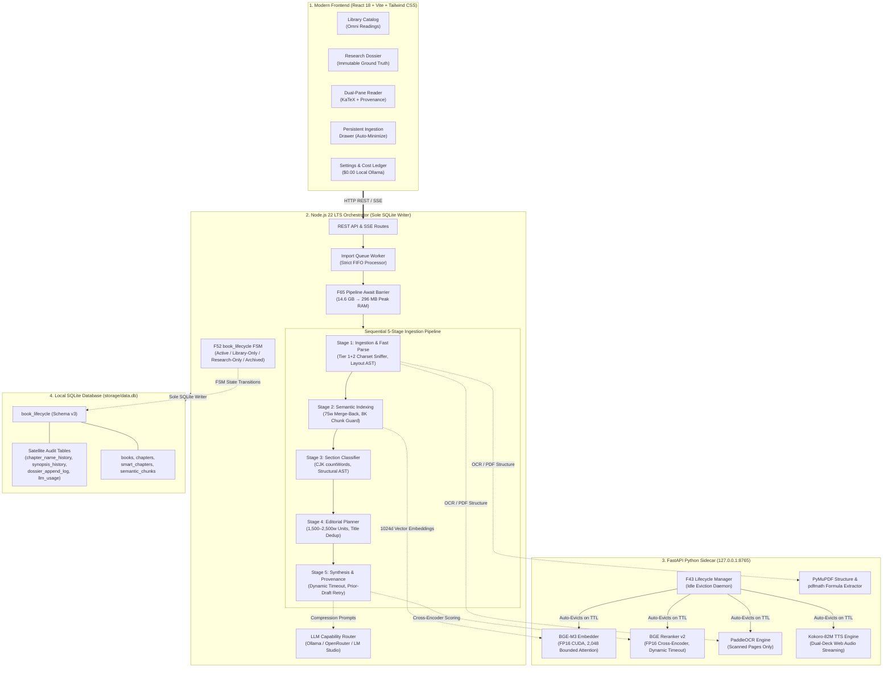
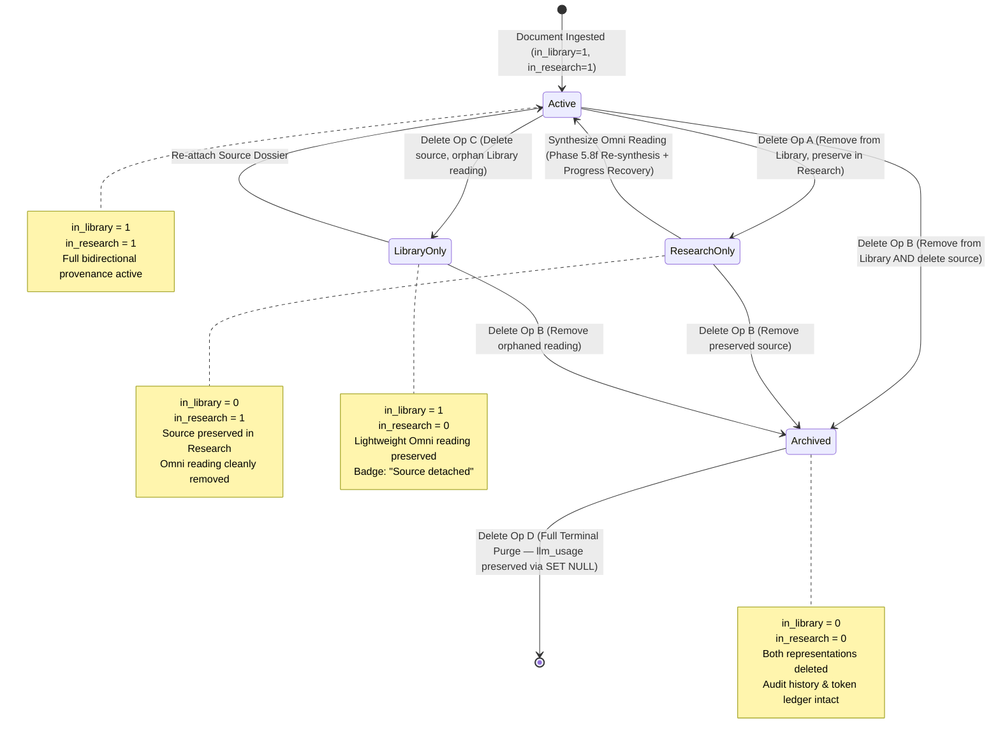
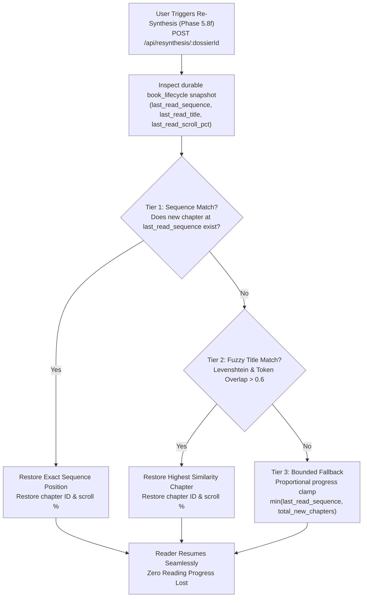
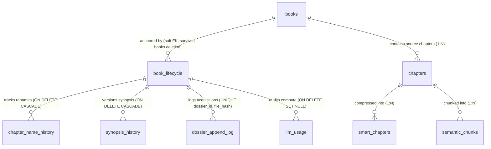
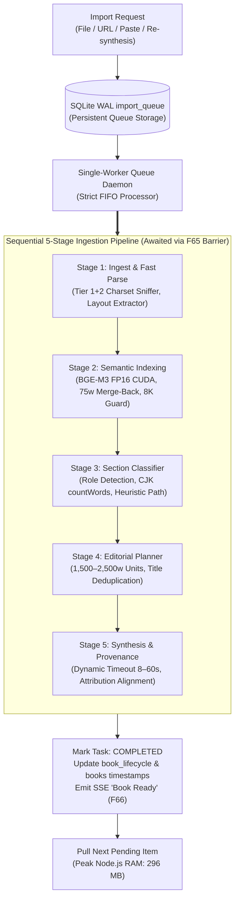
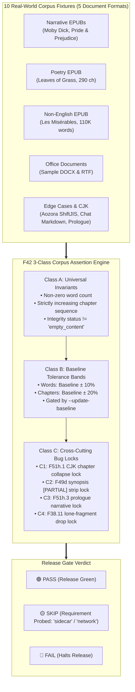
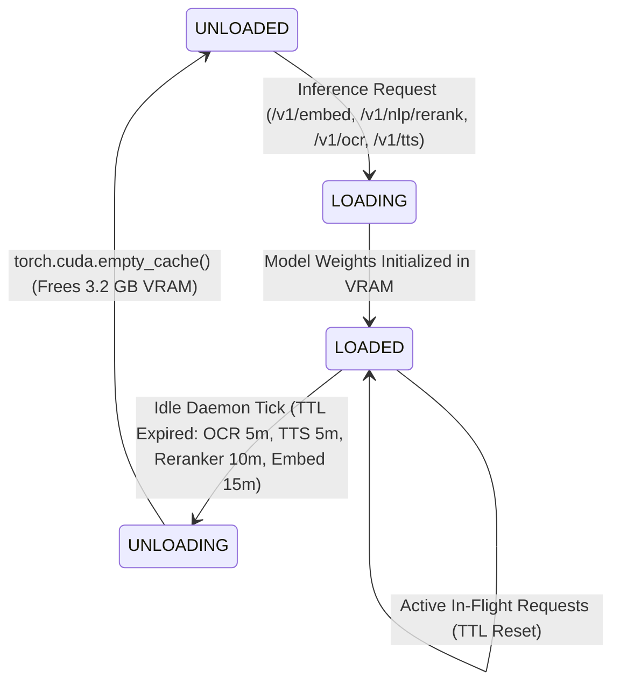

# Omnitome System Architecture & Engineering Specification

> Comprehensive architectural specification for the Omnitome desktop container, asynchronous multi-process topology, vector attribution bounds, and pipeline reliability guarantees.

---

## 🏛️ Foundational Invariant: The Two-Representation Model

Omnitome enforces an uncompromising product identity founded on the formal separation of immutable ground truth from derived semantic syntheses:

| Representation | Placement | Operational Philosophy & Governance |
| :--- | :--- | :--- |
| 📄 **Original Reading** | **Research View** | **Immutable Ground Truth.** The verbatim document exactly as uploaded. Nothing in the system modifies, truncates, or rewrites it. Governed by **Law 1: *"Source is paper"*** — neutral, calm, book-like typography serving as authoritative ground truth. |
| 🧠 **Omni Reading** | **Library View** | **Derived Reading Lens.** An adaptively compressed representation ($\sim 7:1$ semantic density) preserving core concepts, arguments, and evidence. Governed by **Law 2: *"The lens is tinted"*** and **Law 3: *"Derivation never masquerades as source"*** — every claim retains deterministic paragraph-level provenance. |

```text
┌────────────────────────────────────────────────────────────────────────────────────────┐
│                          THE TWO-REPRESENTATION INVARIANT                              │
├────────────────────────────────────────────────────────────────────────────────────────┤
│ 📄 ORIGINAL READING (Research View)                                                    │
│    • Ground Truth Corpus: Raw PDF / EPUB / DOCX / RTF / TXT / Markdown / Web          │
│    • Pristine Verbatim Text: Immutable, never rewritten, never modified                │
│    • Structural Units: Chapters, sections, paragraphs, tables, math formulas           │
└──────────────────────────────────────────┬─────────────────────────────────────────────┘
                                           │
                                           │  Loss-Bounded Semantic Compression (~7:1)
                                           │  BGE-M3 (1024d) + BGE Reranker v2 (FP16)
                                           │  Deterministic Sentence-to-Paragraph Provenance
                                           ▼
┌────────────────────────────────────────────────────────────────────────────────────────┐
│ 🧠 OMNI READING (Library View)                                                         │
│    • Derived Reading Lens: Dynamically compressed into 250–360 words per chapter       │
│    • Clickable Bi-directional Citations: Direct links back to exact source paragraphs  │
│    • Defect Styling: Sentences without provenance rendered in muted dotted style       │
└────────────────────────────────────────────────────────────────────────────────────────┘
```

### Formal Mathematical Grounding

Let a source document $\mathcal{D}_{\text{source}}$ consist of an ordered sequence of $N$ paragraphs $\mathcal{P} = \lbrace p_1, p_2, \dots, p_N \rbrace$. The derived Omni representation $\mathcal{D}_{\text{omni}}$ consists of $M$ synthesized chapters $\mathcal{S} = \lbrace S_1, S_2, \dots, S_M \rbrace$, where each chapter contains a sequence of sentences $S_k = (s_{k,1}, s_{k,2}, \dots, s_{k,|S_k|})$.

1. **Semantic Compression Bound:**
   $$C_r = \frac{\sum_{i=1}^N |W(p_i)|}{\sum_{k=1}^M |W(S_k)|} \approx 7.0 \pm 1.0$$
   where $|W(\cdot)|$ evaluates effective word count (with CJK glyphs weighted at $\alpha = 0.70$).

2. **Provenance Attribution Mapping:**
   For every derived sentence $s \in S_k$, the provenance engine assigns an attribution set $\mathcal{A}(s) \subseteq \mathcal{P}$:
   $$\mathcal{A}(s) = \lbrace p_i \in \mathcal{P} \mid \Phi(s, p_i) \ge \tau_{\text{provenance}} \rbrace$$
   where the hybrid scoring function $\Phi(s, p_i)$ combines dense bi-encoder cosine similarity and FP16 cross-encoder re-ranking:
   $$\Phi(s, p_i) = \lambda \cdot \cos\big(\mathbf{e}_{\text{dense}}(s), \mathbf{e}_{\text{dense}}(p_i)\big) + (1 - \lambda) \cdot \sigma\big(\mathrm{logit}_{\text{rerank}}(s, p_i)\big)$$
   
   If $\mathcal{A}(s) = \emptyset$, sentence $s$ is flagged as an unattributed derivation defect and rendered with the visual style `text-ink-muted` and a dotted underline.

---

## 🏗️ Hybrid Multi-Process Topology

Omnitome adopts a specialized multi-process topology separating orchestrational state management from heavy neural compute and native desktop presentation:

1. **Native Desktop Shell (Tauri v2 / Rust):** Manages window lifecycles, intercepts system shutdown signals, dynamically allocates ports, and acts as the process supervisor for child processes.
2. **Interactive Client (React 18.3 / Vite / Tailwind CSS):** Dual-pane and single-pane reading surfaces, KaTeX mathematical typesetting, synchronized audio highlights, theme styling, and shared Web Audio execution.
3. **Orchestrator & State Engine (Node.js 22 LTS / Express 5):** Owns API routing, import queue persistence, editorial planning, LLM provider routing, and database writes. Node.js is the **SOLE SQLite writer**.
4. **Neural & Computation Sidecar (FastAPI / Python 3.10+):** Local microservice (`127.0.0.1:8765`) executing PyTorch FP16 CUDA vectorization, cross-encoder reranking, Kokoro-82M voice synthesis, and OCR parsing.

```text
┌────────────────────────────────────────────────────────────────────────────────────────┐
│                             TAURI v2 DESKTOP SHELL (Rust)                              │
│       • Native Desktop Container & Window Host       • Dynamic Port Discovery          │
│       • Child Process Lifecycle Supervisor           • Clean Tree Teardown (taskkill)  │
└───────────────────────────────────────────┬────────────────────────────────────────────┘
                                            │ Local Webview IPC
                                            ▼
┌────────────────────────────────────────────────────────────────────────────────────────┐
│                      REACT 18.3 FRONTEND CLIENT (Vite + Tailwind CSS)                  │
│       • Dual-Pane Research & Omni Reading            • KaTeX Mathematical Typesetting │
│       • Synchronized Audio Narration Deck            • 5 Theme-Synchronized Palettes   │
└───────────────────────────────────────────┬────────────────────────────────────────────┘
                                            │ HTTP REST / SSE (Port 3000)
                                            ▼
┌──────────────────────────────────────────────┐ ┌───────────────────────────────────────┐
│         NODE.JS 22 LTS ORCHESTRATOR          │ │        FASTAPI PYTHON SIDECAR         │
│ • SOLE Writer to SQLite Database (WAL Mode)  │ │ • PyTorch FP16 CUDA Vectorization     │
│ • F65 Pipeline Sequential Await Barrier      │◄┼── REST (127.0.0.1:8765)               │
│ • Single-Worker FIFO Ingestion Queue Daemon  │ │ • BGE-M3 Embedder (1024d)             │
│ • Peak Resident Memory: 296 MB               │ │ • BGE Reranker v2 Cross-Encoder       │
│ • F52 book_lifecycle State Machine Engine    │ │ • Kokoro-82M Neural Audio TTS         │
│ • Shared Web Audio SFX Player                │ │ • F43 Idle Lifecycle Eviction Daemon  │
└──────────────────────┬───────────────────────┘ └───────────────────────────────────────┘
                       │ SQLite WAL Operations (Sole Writer)
                       ▼
┌────────────────────────────────────────────────────────────────────────────────────────┐
│                        LOCAL SQLITE STORAGE ENGINE (storage/data.db)                   │
│        • WAL Mode (user_version = 3)        • Independent llm_usage Cost Ledger        │
│        • books, chapters, smart_chapters    • durable book_lifecycle Snapshots         │
└────────────────────────────────────────────────────────────────────────────────────────┘
```



---

## 🛡️ F52: Library / Research State Coordination

The F52 architecture decouples the lifecycle of original research dossiers from derived Omni readings. This guarantees that user annotations, reading continuity, and audit histories survive deletion and re-synthesis cycles:



### The Four Delete Operations
1. **Operation A (Remove from Library):** Removes the derived Omni reading (`in_library = 0`, `in_research = 1`, `lifecycle_state = 'research_only'`). The raw source dossier remains fully preserved in Research for future re-synthesis.
2. **Operation B (Archive Both):** Removes the book from the active Library and flags the research dossier as archived (`in_library = 0`, `in_research = 0`, `lifecycle_state = 'archived'`).
3. **Operation C (Delete Source Only):** Deletes the underlying heavy source file while preserving the lightweight Omni reading (`in_library = 1`, `in_research = 0`, `lifecycle_state = 'library_only'`). Provenance badges update cleanly to *"Source detached"*.
4. **Operation D (Terminal Purge):** Permanently purges an archived entry and all associated chunks from storage (`book_lifecycle` row deleted, historical tokens preserved via `ON DELETE SET NULL`).

---

## 🔄 3-Tier Reading Progress Recovery Architecture (Phase 5.8f)

When a user re-synthesizes an Omni reading from an existing Research dossier, Omnitome dynamically recovers their exact reading position without resetting them to chapter 1:



- **Tier 1 (Sequence Match):** Exact 1:1 chapter sequence alignment.
- **Tier 2 (Fuzzy Title Match):** Levenshtein and token overlap matching across chapter titles when chapter boundaries shift due to altered editorial unit distribution.
- **Tier 3 (Bounded Fallback):** Proportional completion fallback ensuring reading progress is never lost.

---

## 🗄️ SQLite WAL Schema v3 Entity Relationship Diagram (ERD)



### Token & Cost Accounting Ledger (`llm_usage`)
- **Accountant Model:** `llm_usage` rows maintain an independent foreign key `ON DELETE SET NULL`. If a book or lifecycle row is purged, historical token expenditures remain intact for audits.
- **Local LLM Zero-Dollar Policy:** Local inference (Ollama) records **`$0.00` actual cost**, displaying cloud-equivalent value saved (e.g., `"Local Ollama (24,100 tokens — $0.00 actual / ~$0.05 cloud value saved)"`).

---

## ⚙️ Ingestion Pipeline Reliability (F65–F72) & Persistent Queue (F58)

The ingestion pipeline executes sequentially through an await barrier, backed by a persistent SQLite WAL queue and dynamic hardware-calibrated backpressure:



1. **Sequential Pipeline Await Barrier (F65):** Ingestion blocks until all 5 stages (including neural synthesis and paragraph attribution) finish before pulling the next queued document. Drops peak Node.js RSS under multi-book import from **14.6 GB to 296 MB (98% drop)**.
2. **Book Ready Semantics (F66):** The UI signals *"Book ready"* only after the entire neural synthesis and attribution pass completes.
3. **Dynamic Reranker Timeout Scaling (F71):** Replaced static 10s timeout with input-calibrated formula:
   $$\mathcal{T}_{\text{rerank}} = \mathrm{clamp}\Big(8000 + (N_{\text{cand}} \cdot N_{\text{para}} \cdot 400) + (N_{\text{para}} \cdot 300), \, 8000,\, 60000\Big) \, \text{ms}$$
   This completely eliminates false centroid fallbacks on large chapters.
4. **Capacity-Aware Sidecar Backpressure (F72):** Non-blocking `/v1/lifecycle/status` polling with jittered 400–800ms backpressure retries when sidecar worker saturation reaches concurrency limits.
5. **Persistent SQLite Queue Worker (F58):** Background WAL queue worker with live stage checklist widget, paste wizard with mojibake fix, and expanded web discovery (arXiv, Gutenberg, IETF, Wikipedia).

---

## 🎧 Sensory & Perceptual Architecture

### Local Neural Speech Pipeline (Kokoro-82M)

```text
┌────────────────────────────────────────────────────────────────────────────────────────┐
│                        KOKORO-82M NEURAL SPEECH PIPELINE                              │
├───────────────────┬────────────────────────────────────────────────────────────────────┤
│ 1. Segmentation   │ Sentence-boundary splitting with citation bracket filtering        │
│ 2. Text Normalizer│ Strips citation tags ([p12], [4]); emits 250ms synthetic silence   │
│ 3. Phonemization  │ Local espeakng_loader dictionaries + spaCy en_core_web_sm          │
│ 4. Neural Engine  │ Kokoro-82M ONNX/PyTorch model (FP16 CUDA with CPU fallback)        │
│ 5. Dual-Deck Deck │ Native Web Audio AudioBufferSourceNode prefetching next sentence   │
│ 6. Real-Time Sync │ Sentence highlighting and auto-scroll with manual gesture override │
└───────────────────┴────────────────────────────────────────────────────────────────────┘
```

- **Shared AudioContext Architecture:** Both procedural UI sound effects (`soundPlayer.ts`) and neural speech synthesis (`useTtsPlayer.ts`) share an unlocked master `AudioContext` initiated on the first user interaction, permanently circumventing browser and WebView2 autoplay blocks.
- **Dual-Deck Gapless Playback:** Preloads and synthesizes adjacent sentence WAV buffers ahead of the playhead, completely eliminating audio pauses and phrase boundary latency.

### Procedural UI Sound Engine

- **Offline DSP Synthesis Pipeline:** 90 WAV stems across 5 themes generated via a deterministic Node.js DSP pipeline (`tools/sound-design/generate.mjs`) employing subtractive FM synthesis, biquad resonant filtering, pink/white noise, ADSR envelope shaping, and $-3\text{ dBFS}$ peak normalization.
- **Narration Ducking:** Operational sound effects are automatically suppressed while neural narration is active (`setKokoroNarrationActive(true)`).

---

## 🛡️ F42: 3-Class Diverse Corpus Release Gate

The F42 release gate enforces three distinct assertion classes across 10 diverse reference fixtures spanning 5 document formats:



- **Class A (Universal Invariants):** Invariants that must hold for every document regardless of format: non-zero word count, monotonic chapter sequence, and non-empty content integrity.
- **Class B (Baseline Tolerance Bands):** Verifies that parsing output stays within $\pm 10\%$ words and $\pm 20\%$ chapters compared to committed golden baselines.
- **Class C (Regression Bug Locks):** Locks specific historical edge-case bugs:
  - `C1`: CJK chapter boundary collapse prevention.
  - `C2`: Synopsis `[PARTIAL]` tag stripping verification.
  - `C3`: Prologue narrative categorization protection.
  - `C4`: Lone fragment omission lock.

---

## 🔄 Sidecar Model Lifecycle State Machine (F43)

To maintain workstation responsiveness on consumer hardware, the Python sidecar incorporates an automated lifecycle eviction daemon:



- **Per-Model Time-To-Live (TTL):**
  - Kokoro TTS: 5 minutes
  - PaddleOCR: 5 minutes
  - BGE Reranker v2: 10 minutes
  - BGE-M3 Embedder: 15 minutes
- **Idle Daemon:** Runs every 10 seconds in a background thread; evicts models only when active in-flight requests equal zero.
- **VRAM Reclaim:** Reduces idle sidecar VRAM to **174 MB**, returning **3.2 GB of GPU VRAM** to the user's host workstation.
